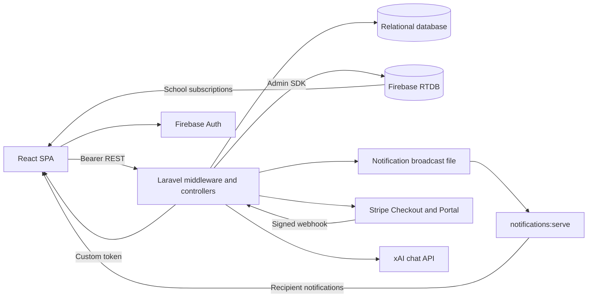

# System Architecture

Source snapshot: 2026-10-13, working tree based on `f139bf6`, including pre-existing uncommitted changes. Verified means observed in source, not deployed or exercised against live services. See [AGENTS.md](AGENTS.md) and [PRD.md](PRD.md).

## Runtime Structure

The React SPA calls a Laravel JSON API using Sanctum bearer tokens. Relational storage owns business state. Laravel projects active trips into Firebase RTDB, which browsers subscribe to using Firebase Auth custom tokens. An optional PHP WebSocket process reads a local notification broadcast file.

## Firebase Projection Recovery

MySQL is authoritative for school membership. Membership mutations create `FirebaseSyncFailure` records containing the target user/school, desired role/active state, lifecycle status, attempt/error timestamps, and retry time. `RetryFirebaseProjection` is dispatched after commit. A newer desired state supersedes older pending rows; each retry re-checks the current SQL account and school before writing Firebase, so a stale job cannot restore access. Super Admins can list and manually retry unsynced membership rows through the protected API.

## Stack and Responsibilities

Dependency ranges come from `bus-backend/composer.json` and `bus-frontend/package.json`; installed/deployed versions were not audited.

| Layer | Implementation |
| --- | --- |
| API | Laravel 12 / PHP >=8.2; Sanctum 4; Eloquent; controllers validate, authorize, transact, and serialize |
| UI | React 19 / Router 7 / Vite 8; JavaScript/JSX; Tailwind 4 and CSS; Framer Motion; React Icons; Chart.js and Recharts |
| Maps | Leaflet 1.9 / React-Leaflet 5; OpenStreetMap tiles; browser geolocation |
| Integrations | Kreait Firebase 7, Stripe PHP 20, Laravel Excel 3.1.69; Laravel HTTP client for xAI |
| Testing | PHPUnit 11 / Mockery; ESLint 9; no frontend test script |

`src/main.jsx` wraps the app in AuthProvider and RealtimeProvider. `src/App.jsx` supplies language state, routing, guards, error boundary, and toasts. Routes include `/choose-role`, `/signin`, `/admin/*`, `/driver/*`, `/parent`, `/super-admin`, and `/chat`; `/signup` redirects to sign-in. Domain pages use local React state and `src/api/*`; some components call the shared Axios client directly. There is no Redux store.

Middleware aliases live in `bus-backend/bootstrap/app.php`; groups live in `routes/api.php`. Models use `BelongsToSchool`, supplemented by controller predicates. No database row-security policy is configured. See [DATABASE.md](DATABASE.md) and [API.md](API.md).

## Authentication and Realtime

`AuthController` issues Sanctum tokens; login deletes prior tokens, logout deletes the current token. `AuthContext.jsx` stores `token` and `auth_user`, refreshes `/me`, requests `/firebase-token`, and signs into Firebase. Firebase login failure is logged without rejecting REST login. Profile-fetch failure clears client authentication even for network errors.

`FirebaseService::createCustomTokenForUser` uses Laravel ID as Firebase UID and synchronizes membership. `RealtimeContext.jsx` listens to both school collections and exposes `activeTrips`, `activeBuses`, and derived `busLocations`. `useTripForBus` returns a trip ID; `useActiveTripById` returns its object.

| RTDB path | Meaning |
| --- | --- |
| `school_users/{schoolId}/{uid}` | Backend-written role, active flag, busId, updatedAt |
| `active_trips/{schoolId}/{tripId}` | Trip/bus/driver IDs, type/status, timestamps, live_location, live_attendance |
| `active_buses/{schoolId}/{busId}` | Current trip_id lookup and timestamp |
| `notifications/{schoolId}/{uid}` | Rules exist; current notification transport uses SQL and WebSocket file |

Rules deny client writes. Active school membership grants reads across the school's trip/bus collections; role/child filtering is not enforced there. See [SECURITY.md](SECURITY.md).

## GPS and Trip Flow

`DriverPage.jsx` obtains a browser position immediately and every five seconds during a trip, then calls `pingDriverLocation`. The API enforces coordinate bounds and a driver-owned active trip. It persists latest bus coordinates, projects location, and optionally measures distance to the selected student. Alerts use 2000m and 50m thresholds and two-hour cache keys. This is not an ETA prediction engine or persisted GPS history.

Start locks the bus within a SQL transaction, completes the trip selected by `Bus::activeTrip`, resets students, and inserts trip/presence rows. Notification creation and Firebase calls follow. Completion upserts attendance and updates trip/bus state before notification and Firebase work. These systems do not share an atomic transaction.

## Background Processing and Limitations

- `NotificationBroadcaster` appends JSON to `storage/app/notification-broadcasts.log`; `notifications:serve` tails new entries and sends them to recipient sockets. Driver/parent pages also poll every 15 seconds. No acknowledged delivery or distributed transport is implemented.
- `RetryFirebaseProjection` uses bounded Laravel queue attempts with 60/300/900/1800-second backoff. Production requires a running worker: `php artisan queue:work --queue=default --tries=5`. A recovery dispatcher runs every minute through `php artisan schedule:work` and executes `php artisan firebase:dispatch-membership-syncs --limit=100`; it claims due rows with a short lease before dispatching, and records dispatch failures for another retry. No claim is made that workers or the scheduler are supervised in deployment.
- Firebase membership state is visible through the Super Admin sync endpoints. The API reports `pending`, `failed`, or `synced`; it does not claim Firebase success before the Admin SDK operation completes. Trip and lookup writes remain separate calls.
- `completeTrip` unconditionally removes the bus lookup; delayed old-trip cleanup can remove a newer lookup. `Bus::activeTrip` only selects today's latest active trip, so cleanup is not comprehensive across dates.
- `DriverController::dashboard` preserves today's active trip on reload. The erroneous date-object/string cleanup comparison was removed and covered by a regression test. Its separate no-active-trip normalization still mutates bus/student state.
- Bootstrap endpoints mostly load entire school collections. Archive/analytics use derived/mock data in `mockDashboardData.js`, not an historical reporting API.

## Configuration and Deployment

Database connection is environment-selected; `config/database.php` defaults to SQLite and includes MySQL. README describes MySQL development; actual deployment configuration was not read. Queues default to database. `composer run dev` starts API, queue listener, logs, and backend Vite; the separate SPA uses root NPM proxies.

Relevant variable names: `DB_CONNECTION`, `DB_*`, `APP_KEY`, `APP_DEBUG`, `FRONTEND_URLS`/`FRONTEND_URL`, `FIREBASE_CREDENTIALS`, `FIREBASE_DATABASE_URL`, `STRIPE_KEY`, `STRIPE_SECRET`, `STRIPE_WEBHOOK_SECRET`, `XAI_API_KEY`, `XAI_BASE_URL`, `XAI_MODEL`, `QUEUE_CONNECTION`. SPA: `VITE_API_BASE_URL`, `VITE_FIREBASE_API_KEY`, `VITE_FIREBASE_AUTH_DOMAIN`, `VITE_FIREBASE_DATABASE_URL`, `VITE_FIREBASE_PROJECT_ID`, optional `VITE_NOTIFICATIONS_WS_URL`.

The SPA throws at module load without Firebase configuration. Axios defaults to HTTP on hostname port 8000 and has no explicit timeout. Vite exposes its dev server to LAN. Production needs verified HTTPS/WSS, SPA history fallback, Laravel public-directory hosting, worker supervision, storage access, rules deployment, and backups. No production deployment pipeline was found among inspected files; live infrastructure is unverified.
