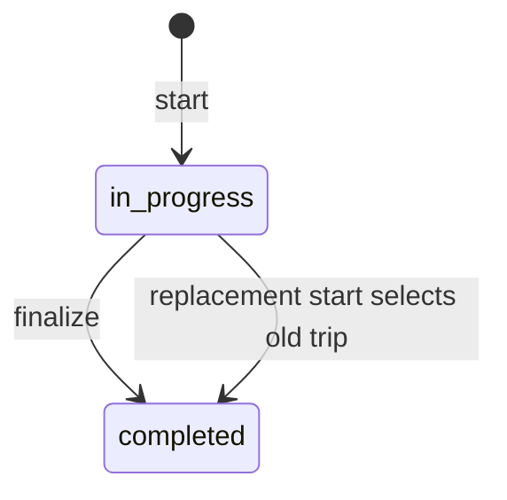

# Business Rules

Console update 2026-10-15: Security displays severity-filtered audit records (warning by default). Settings exposes current account details and the existing browser language preference, not platform-wide configuration. Users supports school-admin creation and refreshes school counts after account updates. Billing remains a read-only overview; no subscription mutation or 2FA capability was added. Successful save dialogs now close, audit reset sends empty filters, and older audit responses cannot replace newer results.

## Super-Admin Realtime Consistency

MySQL is authoritative for membership. Membership changes create a durable `firebase_sync_failures` row with the desired school/user/role/active state before the post-commit projection job runs. Therefore a SQL or audit failure rolls back both the business change and its pending projection; Firebase is not contacted. If SQL commits but Firebase fails, the SQL state remains authoritative, the row is `failed` with attempts/error/next-retry metadata, and the queue retry reconciles Firebase. A later membership state supersedes older pending rows, and retries re-check current SQL eligibility so an older transfer or disable operation cannot restore access.

Firebase token issuance does not create or reactivate a membership projection. A disabled Firebase membership remains disabled until an explicit, authorized membership activation or synchronization flow changes the authoritative SQL state and enqueues the corresponding projection.

Verified source behavior as of 2026-10-13; runtime and concurrency guarantees are not implied. Sources: `bus-backend/routes/api.php`, relevant API controllers, `app/Models`, `app/Imports/StudentsImport.php`. Related: [API.md](API.md), [DATABASE.md](DATABASE.md), [PRD.md](PRD.md).

## Actors and Eligibility

| Actor | Implemented authority |
| --- | --- |
| super_admin | List/create/update schools, change school activation, create/manage school admins, inspect audit logs |
| admin | Own-school fleet, students, driver/parent accounts, assignments, imports, billing |
| driver | Assigned bus dashboard, start trips, attendance, GPS, parent nudges and own notifications |
| parent | Link children via registration code, confirm pickup location, ready/absence, own dashboard/notifications |

Public registration creates only parents. Admin creation is a super-admin route. `updateAdmin` treats `super_admin` as a platform role and clears its school membership; school admins must retain a valid existing school. The current Super Admin cannot disable or demote itself, and the last active Super Admin cannot be disabled or demoted; rejected attempts are audited. School subdomain is stored/validated, not a verified host-based tenant router.

Admin/driver/parent business groups require active user role, active school and eligible subscription. Billing omits subscription eligibility so an active school's admin can recover billing. Null-school parents bypass school/subscription middleware to enable linking; this exception applies to their group, not just the link endpoint. Linking validates the target school explicitly. Common endpoints have different eligibility; see [SECURITY.md](SECURITY.md).

## Fleet, Students, and Ownership

- Bus has at most one driver; driver_id is unique across buses. Reassignment clears previous bus assignments. Disabled drivers cannot be newly assigned by current validators.
- Students belong to at most one parent and one bus. Multiple children may share a parent, but the parent dashboard selects only the first by ID.
- Parent linking trims reg_code, searches outside the school scope, checks school active/subscription, rejects another parent and cross-school linking, then updates parent school (if null) and student parent in a transaction. Prechecks are not row-locked.
- Student assignment/create/update checks capacity; bus capacity reduction below assigned count is rejected. These are count-before-write checks without full concurrency serialization.
- `max_buses` is stored and shown in billing, but bus creation does not enforce this school quota.
- Students may be unassigned. Admin student creation generates an eight-character registration code when omitted. Parent and driver selections require matching school and active role where explicitly validated.
- No separate route/stop/order model exists; route_name is a bus label. Do not describe route optimization or route CRUD as implemented domain functionality.
- Bus deletion is rejected when an in_progress trip exists; otherwise students/driver are detached and the bus is soft-deleted. Core soft deletes retain history rather than erasing it.

## Trip and Attendance Lifecycle

Start accepts aller or retour (default aller). Legacy SQL default pickup still exists. `TripController::start` locks the assigned bus, loads today's latest active trip, completes that trip, resets assigned students to waiting, creates a new in_progress trip and waiting presences, and marks the bus in_progress. It then notifies parents/admins and projects Firebase state. Repeated start is not an idempotent resume: it creates another trip.

The diagram describes trip status, not an enforced attendance state machine. Driver attendance accepts mounted, in_bus, absent. Parent actions set ready or absent; they may change student state without an active trip, but only create/update a presence when today's active trip exists. No monotonic transition rule universally prevents ready/absent after boarding.

Completion requires at least one attendance item with student_id and waiting/mounted/absent/dropped status; optional recorded_at and final_location. It verifies trip driver and in_progress state (otherwise 403/409), checks students belong to the bus, upserts presences, updates students, completes trip/bus and stores final coordinates. It accepts a subset rather than requiring every assigned student. The UI maps boarded students to dropped. Empty-bus completion is not supported by the min:1 payload.

`Bus::activeTrip` is date-filtered. Older active trips are not selected for start cleanup; that limitation remains. Dashboard reload now preserves today's active trip, bus timestamps and attendance: the invalid date-object/string cleanup comparison was removed and regression-tested. The separate no-active-trip normalization remains.

## GPS, Readiness, and Notifications

Only a driver-owned active trip may receive REST GPS pings. Coordinates are bounded to latitude [-90,90], longitude [-180,180]. Bus keeps the latest position; no trajectory table exists. A target student must belong to the trip's bus. Distances use Haversine; alerts fire at <=2000m and <=50m using two-hour cache flags. Cache check then put is not an atomic once-only guarantee. The "five minutes" message is a fixed label, not computed ETA.

Parent confirm-location verifies ownership and writes both coordinate pairs and location_conformee=true. Ready notifies driver; absence notifies driver and active school admins. Trip start/completion and driver attendance notify linked parents/admins. Nudge requires an active driver-owned trip, bus student and linked parent. Notifications are persisted, optionally broadcast and polled; reading marks the current recipient's unread records. API list limits are 20 for driver/admin and 50 for parent.

Firebase is a secondary projection. Membership failures are durably recorded and visible to Super Admins at `/api/super-admin/firebase-syncs`; manual retry uses `/api/super-admin/firebase-syncs/{sync}/retry`. Trip projection failures retain the existing retry path. Old-trip cleanup can remove a newer bus lookup. See [ARCHITECTURE.md](ARCHITECTURE.md); live provider recovery remains an operational dependency.

## Imports and Account Onboarding

Header parsing accepts xlsx/csv/xls <=10MB and stores a school-specific temporary file. Finalize validates that path and mapping (student_name and parent_cin required), imports in a transaction, then deletes the file. Rows missing name/CIN are skipped. Parents are matched by school/CIN and students by school/name/parent; these are not database unique constraints. Generated fallback emails include school ID; passwords are randomized and not retained for delivery.

The separate import-preview endpoint actually persists rows and creates parents by email; it is not read-only preview. Automated parent invitation/password recovery is absent from routed APIs. WhatsApp actions open wa.me links in the browser, not a verified delivery service.

## Subscription Rules

`School::isSubscribed` permits active/trialing unless hasExpired; future trial or grace dates independently permit access. hasExpired checks canceled/incomplete_expired/unpaid/past_due when no trial/grace remains. These exact predicates, not general billing intuition, govern middleware.

BillingController currently defines monthly USD Starter $29/5 buses, Pro $79/20, Enterprise $199/10000. They are code values, not approved Moroccan pricing commitments; quota enforcement is incomplete. Subscribe creates a Stripe customer if needed and a Checkout session; portal requires an existing customer. Return URLs are validated as URLs, not origin-allowlisted.

Webhook requires signature, inserts a unique event log and handles subscription created/updated/deleted and invoice.payment_failed. Existing event IDs return duplicate=true regardless of prior status. A failed event is therefore not replayed on redelivery; out-of-order events have no version guard. External billing delivery/recovery remains unverified.
