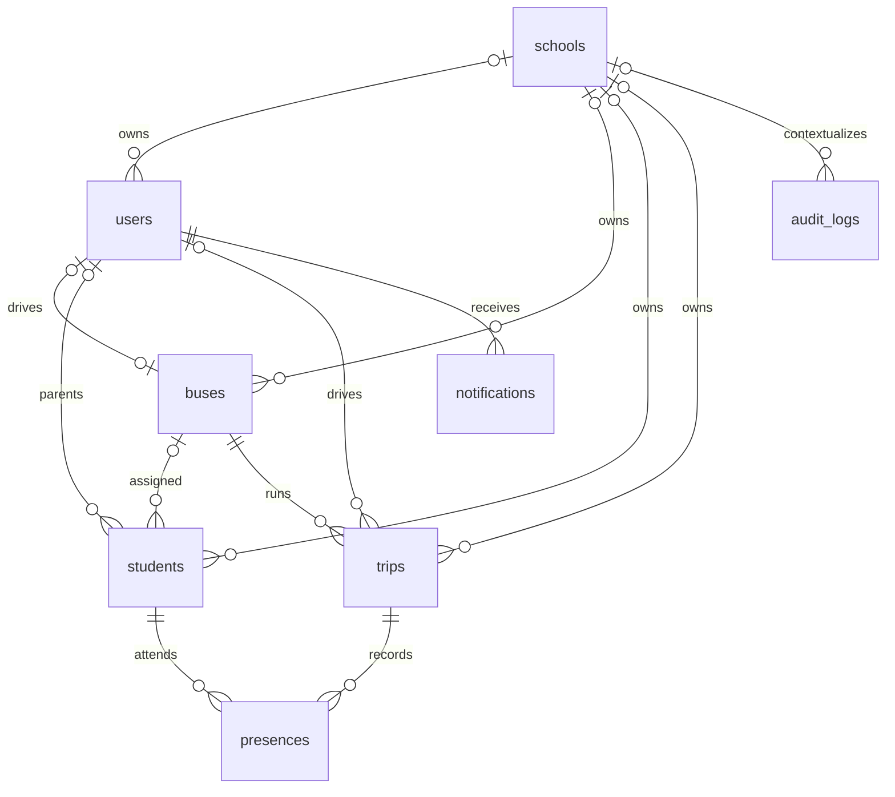

# Database Design

Source snapshot: 2026-10-13. This describes migrations, not a live schema; application of migrations is unverified. Sources: `bus-backend/database/migrations/*.php`, `app/Models/*.php`, `config/database.php`. Related: [ARCHITECTURE.md](ARCHITECTURE.md), [BUSINESS_RULES.md](BUSINESS_RULES.md), [SECURITY.md](SECURITY.md).

## Engines and Notation

`DB_CONNECTION` selects the engine (configuration fallback SQLite); README describes MySQL development. PHPUnit selects SQLite `:memory:`. Role-enum alterations are MySQL-specific. No migrations were executed for documentation.

`?` means nullable; `timestamps` means created_at and updated_at. `id` means auto-incrementing bigint primary key unless stated otherwise. Strings use Laravel's default length unless specified. FK delete actions below concern hard deletion.

## Domain Tables

| Table | Columns after repository migrations |
| --- | --- |
| schools | id; name string; subdomain string unique; logo_path?, primary_color? strings; max_buses unsigned int default 0; is_active boolean default true; subscription_status string default active; stripe_customer_id?, stripe_subscription_id?, stripe_price_id? strings; trial_ends_at?, subscription_ends_at? timestamps; timestamps |
| users | id; name; email unique; email_verified_at? timestamp; password; school_id? FK; role enum (MySQL: super_admin/admin/driver/parent, default parent); phone?, cin? strings; status string default active; remember_token? string; timestamps; deleted_at? |
| buses | id; school_id? FK; bus_name; plate_number unique; route_name?, school_name? strings; capacity int default 20; driver_id? unique FK; latitude_actuelle?, longitude_actuelle? decimal(10,7); trip_status string default idle; trip_started_at?, trip_completed_at? timestamps; timestamps; deleted_at? |
| students | id; school_id? FK; full_name; grade? string; address? text; reg_code unique string; parent_id?, bus_id? FKs; home_lat?, home_lng?, latitude?, longitude? decimal(10,7); location_conformee boolean default false; status string default waiting; timestamps; deleted_at? |
| trips | id; school_id? FK; bus_id FK; driver_id? FK; type string default pickup; trip_date date; status string default in_progress; started_at?, completed_at? timestamps; timestamps; deleted_at? |
| presences | id; school_id? FK; student_id, trip_id FKs; status string; recorded_at timestamp; timestamps; unique(student_id, trip_id) |
| notifications | id; school_id? FK; recipient_user_id FK; parent_id?, student_id?, bus_id?, trip_id?, created_by_user_id? FKs; type string default info; title string; message text; date_envoi? timestamp; payload? JSON; read_at? timestamp; timestamps |
| audit_logs | id; user_id?, school_id? FKs; action string; severity string default info; description text; auditable_type? string; auditable_id? unsigned bigint; old_values?, new_values? JSON; ip_address? string(45); user_agent? text; timestamps |
| stripe_webhook_logs | id; stripe_event_id unique string; event_type string; status string default processing; payload? JSON; processed_at? timestamp; timestamps |
| firebase_sync_failures | id; operation string; context JSON; attempts unsigned int default 0; last_error? text; completed_at? timestamp; timestamps. Unfinished recovery infrastructure, not written by controllers. |

No routes, stops, guardian-link pivot, GPS-history, or separate subscriptions table exists in the migrations. Route is a bus label; subscriptions live on schools.

## Framework Tables

| Table | Columns and constraints |
| --- | --- |
| personal_access_tokens | id; indexed tokenable_type/tokenable_id polymorphic pair; name text; token string(64) unique; abilities? text; last_used_at?, expires_at? timestamps (expires_at indexed); timestamps |
| password_reset_tokens | email string primary key; token string; created_at? timestamp |
| sessions | id string primary key; user_id? unsigned bigint indexed, no declared FK; ip_address? string(45); user_agent? text; payload longtext; last_activity int indexed |
| cache | key string primary key; value mediumtext; expiration int indexed |
| cache_locks | key string primary key; owner string; expiration int indexed |
| jobs | id; queue string indexed; payload longtext; attempts unsigned tinyint; reserved_at? unsigned int; available_at and created_at unsigned ints |
| job_batches | id string primary key; name; total_jobs/pending_jobs/failed_jobs ints; failed_job_ids longtext; options? mediumtext; cancelled_at?, finished_at? ints; created_at int |
| failed_jobs | id; uuid unique string; connection/queue text; payload/exception longtext; failed_at timestamp default current time |

Laravel maintains a migration ledger outside these application table definitions. Password-reset storage exists without routed recovery endpoints.

## Relationships and Deletion

Tenant FKs on users/buses/students/trips/notifications/presences cascade on school hard deletion. Bus and trip driver references set null on user deletion. Student parent sets null; student bus cascades. Trips cascade with buses; presences cascade with students/trips. Notification recipient cascades; optional user/student/bus/trip references set null. Audit user/school set null; auditable references have no FK. Stripe and Firebase failure logs have no school FK.

Users/buses/students/trips use SoftDeletes. Admin bus deletion detaches students/driver and rejects active trips; parent deletion detaches children; driver deletion detaches buses. Globally unique values remain reserved after soft deletion. No scheduled purge, restore API, or retention period was found. Webhook payloads, audit snapshots, location/contact/CIN data and broadcast logs need retention/access decisions.

## Indexes and Integrity

Global unique keys: school subdomain, user email, bus plate, bus driver_id, student reg_code, token hash, webhook event ID, failed-job UUID. Presence uniqueness is student/trip. No unique constraint enforces a single active trip per bus, school/parent CIN, or import name/parent matching.

`2026_07_21_000001_add_performance_indexes.php` adds:

- Users: (school_id, role, status), (school_id, name), (school_id, cin).
- Buses: school_id paired with bus_name, trip_status, driver_id.
- Students: school_id paired with full_name, bus_id, parent_id, status, reg_code.
- Trips: (school_id, trip_date, status), (school_id, bus_id, trip_date), (school_id, driver_id, status), (bus_id, status, trip_date), (driver_id, status).
- Notifications: (school_id, recipient_user_id, read_at), (recipient_user_id, created_at), and school_id/type|bus_id|student_id/created_at triples.
- Presences: (school_id, trip_id, status), (school_id, student_id, recorded_at), (school_id, status, recorded_at).
- Schools: (subscription_status, is_active), stripe_customer_id, stripe_subscription_id (nonunique).
- Webhook logs: (status, created_at), (event_type, created_at). Audit logs: (school_id, created_at), (user_id, created_at); original migration also indexes (auditable_type, auditable_id), (action, created_at), (severity, created_at).
- Firebase failure migration indexes (operation, completed_at).

Individual FKs do not enforce matching school_id across referenced entities. `BelongsToSchool` scopes authenticated non-super-admin queries and assigns school_id on creation; raw inserts bypass events. Capacity checks are application queries, not database constraints or serialized reservations.

## Model and Migration Differences

Use forward migrations and review MySQL/SQLite differences. Historical migrations add then drop `default_password`; do not reintroduce plaintext passwords. User passwords are hashed; Sanctum stores token hashes. Location/CIN/contact columns have no encryption casts.

Presence disables automatic timestamps despite timestamp columns; bulk start inserts populate them while other paths may not. Both home_lat/home_lng and latitude/longitude exist. SQL bus capacity/type defaults (20/pickup) differ from API defaults (24/aller). Actual deployed schema, orphan data, encryption at rest, and restore behavior are unverified.
